# bh-client
The unmodified Brawlhalla game on the new engine (HashLink + Heaps, from Bifrost's engine port: the `engine` branch of
[bifrost](https://github.com/Saorax/bifrost), checked out next to this folder as `bifrost-engine`, or set
`BIFROST_ENGINE`), playing on the official servers, with client-side performance and stability fixes, and Bifrost's
client-side UI. This repo has no game code, art or files.

### **Accounts that play with a modified client could be banned by Blue Mammoth Games or Ubisoft.**
### **I am not responsible if you do get banned.**  
- This is a fresh release, so the probability of being banned is unknown
- Nothing at all modifies the official servers in any way. This client talks to the servers as 1 to 1 as the official client
- Please ask tournament organizers if you are allowed to use this client, as a modified client is under the **official Brawlhalla rulebook (Section 5 Point 1)**

## Features

Everything below is client-side: it runs on your PC and sends nothing extra to Blue Mammoth Games or Ubisoft. Settings are saved in
`bh-mod-settings.json` in the mode's saves.

**Game and connection**
- The unmodified game on the official servers, on a completely new engine (HashLink + Heaps) instead of Adobe AIR.
- Logs in with your install's own Steam extension, so your account works as usual.
- The game's own telemetry runs as in the stock game, through your install's `DnaManager` extension.
- The game's in-game videos play, through Windows Media Foundation.
- The game's taskbar flash, Maximized window mode, `-multikeyboard` (your install's own extension), Copy Image, alt-tab
  handling, redirects and shutdown when the window is closed all work as they do in the stock game. Settings are written
  when the game exits, connecting to a server no longer freezes the game, and a second launch leaves the running game alone.
- If a renderer can't start on your PC, the launcher moves on to the next one (DirectX 11, Vulkan, DirectX 12), saves it
  and says why in `logs/launcher.txt`.

**Performance and display** (Options, GRAPHICS)
- Frame pacing (F11), frame rate (monitor, unlimited or a number), VSYNC.
- DirectX 11, DirectX 12, or Vulkan renderer.
- Display mode: the game's setting, windowed, borderless or exclusive fullscreen.
- Stats overlay (F12): FPS, frame time, ping, match packets per second and the longest gap, the match server's region
  (for example `US-W (California)`), clock and memory. Ping is the game's own round trip to the
  match server (the median of the last 5), or the lobby connection outside a match.
- Screen shake strength, steady blinking legends when respawning, KO effect opacity.
- Skin effects: crossover, Ascended and weapon skins can use the base legend's or weapon's effects and sounds, with
  exceptions per skin.
- Screenshots (Ctrl+F12), hide the HUD (Shift+F12), free camera (Ctrl+Shift+F12: drag to move, wheel to zoom).

**Menus**
- Bifrost's Options: SYSTEM, PREFERENCES, GRAPHICS, CONTROLS and MORE. Key bindings save where the game saves them.
- Bifrost's lobby settings page (game rules, lobby, rule presets) and Training settings page. Each has a button to
  switch to the game's own page and back.
- The match loading screen shows the map's art and starts its music early.

**Ranked**
- Match preview: tier tags and side panels with your projected win and loss.
- The ranked card in character select.

**Training**
- Saved states: F1 saves, F2 loads, 5 slots.
- Dummy recording: Shift+F1 records, Shift+F2 replays on a loop, Ctrl+F2 once. 5 slots.
- Frame data (Ctrl+F1), hitbox trail (Ctrl+F3).
- Bot DI after hits (Ctrl+F4) and bot recovery (Shift+F4).
- The key list overlay (F9).
- A second local player can join.
- **Online training with a Steam friend** (Training settings, ONLINE TRAINING tab). It runs between your two PCs
  through Steam, with no game server:
  - Your Steam friends in a list in Brawlhalla.
  - Either player can change the map while playing.
  - Shared pause (F7), frame step (F6) and step back (F5); Training setting changes apply to both.
  - Rollback netcode with a desync check. Saved states are off online.
  - Both players need the same bh-client version. 

**Replays and match stats**
- A Replays page in place of the game's list (switch back in Options):
  - Recent, Favorites and Older folders;
  - each replay listed by its file name with its stage, game mode and legends;
  - quick filters you can combine (wins, losses, 1v1, 2v2), and filters by legend, map, opponent, mode and tag;
  - each match's players and a KO timeline: watch from any KO;
  - notes and tags.
- Match stats kept for every match you play, and for any replay with GET STATS (no need to watch it through).
- WATCH REPLAY on the scoreboard opens the match's replay once it's saved.
- KEEP RECENT moves older replays to an Older folder (nothing is deleted).
- Video export (Ctrl+F9 while a replay plays).
- MATCH STATS on the scoreboard (Tab, or R3 on a controller) and in replays (Tab): damage, falls, dodges, combos, a
  damage graph and your top attacks, also for official online matches.

**Controls**
- Input display in matches and Training: your key binds, or Xbox, DualShock 4, DualSense and Switch Pro drawings;
  optionally teammates' or everyone's inputs.
- Controllers are ignored while the window isn't focused, and unplugging one mid-match is safe.
- Legend Setups in character select: saved setups and an all-picks loadout window, with share codes. Only the items
  the game lists as yours.

**Discord**
- Rich Presence (on by default; Options, PREFERENCES): gamemode, lobby, queue or match, teammates and opponents, map and
  legend art, elapsed time.

## Screenshots

<table>
<tr><td width="50%">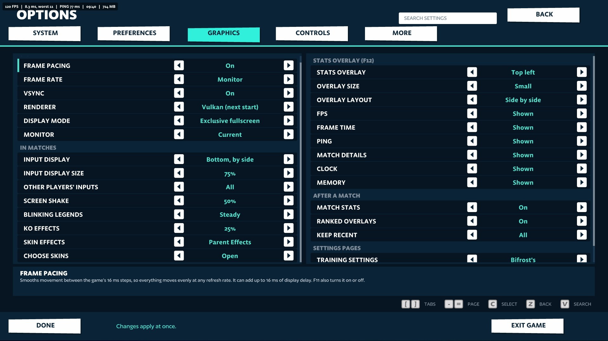<br>Options, GRAPHICS</td><td width="50%">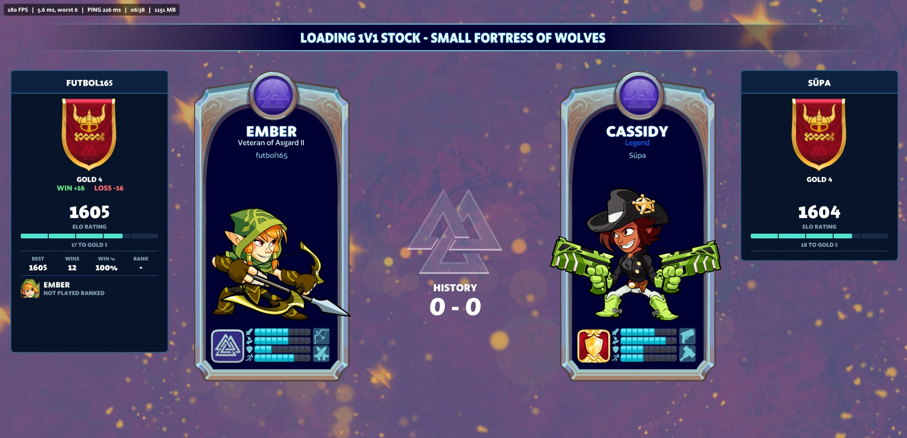<br>Ranked loading screen with the projected win and loss</td></tr>
<tr><td width="50%">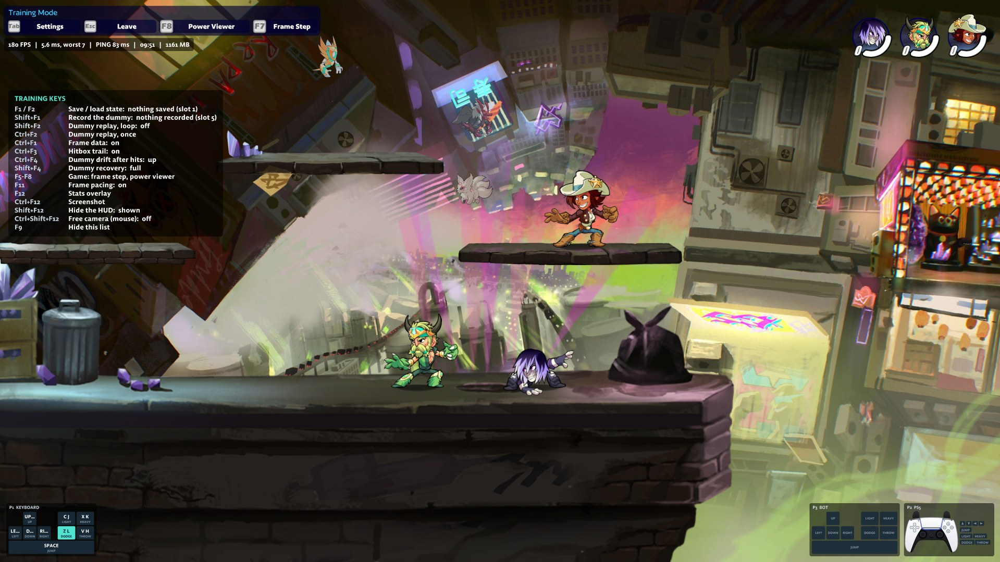<br>Training with the key list and input display</td><td width="50%">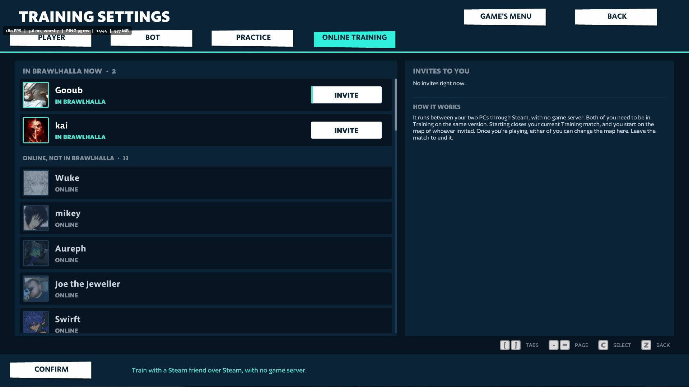<br>Online training with a Steam friend</td></tr>
<tr><td width="50%">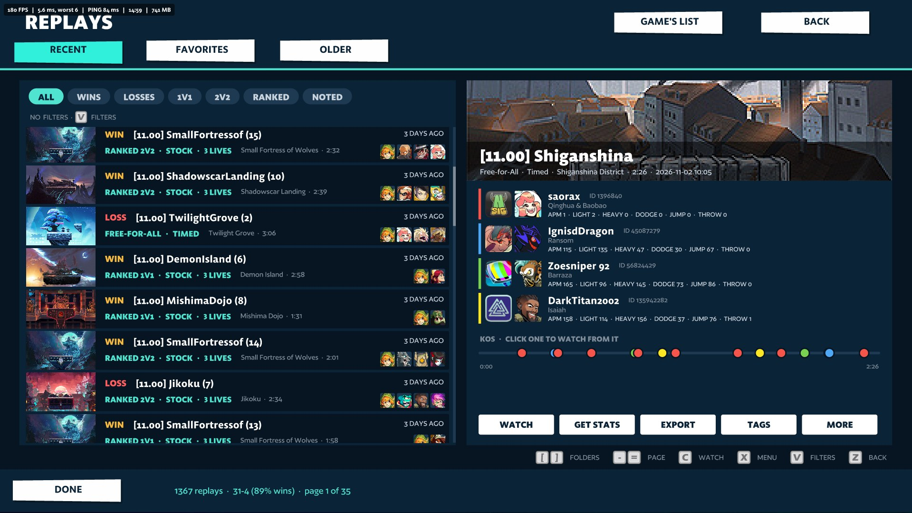<br>Replays with quick filters and a KO timeline</td><td width="50%">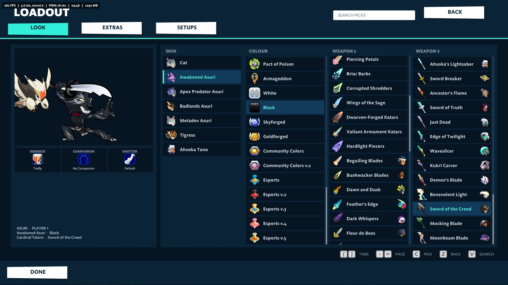<br>Loadout: skin, colour and weapons</td></tr>
<tr><td width="50%">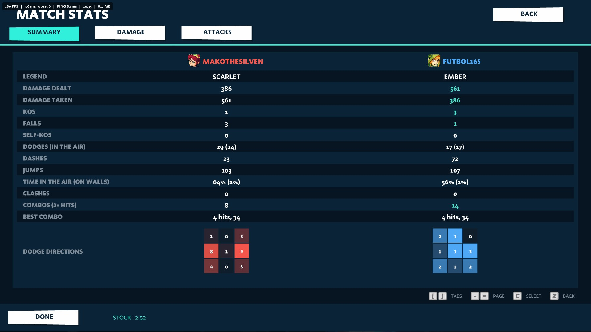<br>Match stats: summary</td><td width="50%">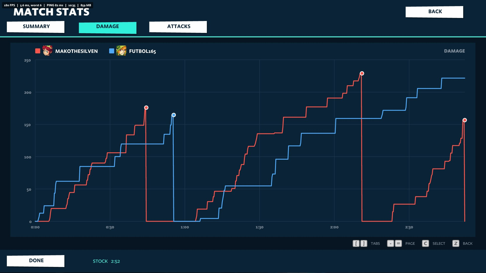<br>Match stats: damage over the match</td></tr>
<tr><td width="50%">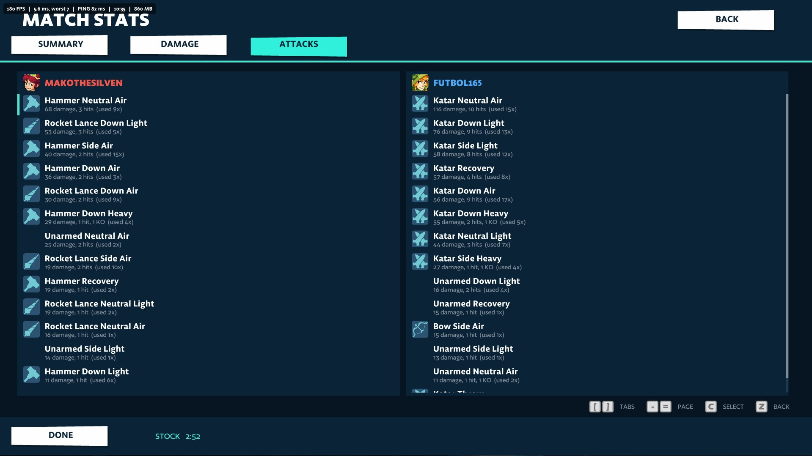<br>Match stats: attacks</td><td width="50%">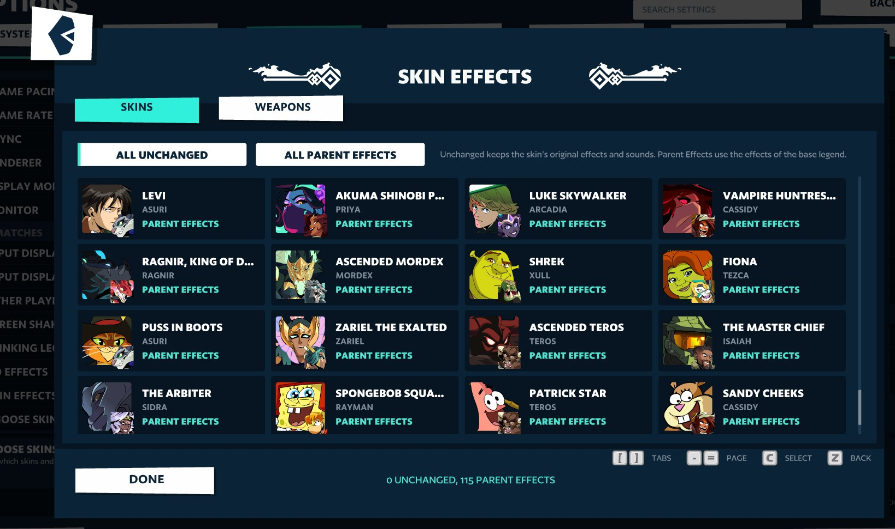<br>Skin effects</td></tr>
<tr><td width="50%">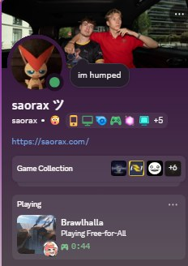<br>Discord Rich Presence</td></tr>
</table>

## Use

```bat
python tools/nc.py export
python tools/nc_bifrost.py
python tools/nc.py build
python tools/nc.py run --game "C:\path\to\Brawlhalla" --offline
python tools/nc.py run --game "C:\path\to\Brawlhalla"
```

- `export` takes the port's raw 11.00 game and Heaps engine into `build/`, writes the
  official overlay and `build-official-<renderer>.hxml` there (`tools/nc_layer.py`) and builds `native/`.
- `nc_bifrost.py` imports Bifrost's client-side classes from the converted Bifrost build (the port's
  `build/bifrost-11.00/export/src`) into `bifrost-gen/`, with the hook lines that only touch them; run it again after a
  Bifrost change.
- `build` rewrites the overlay and compiles `build/engine/official/game-dx11.hl` and `game-dx12.hl`.
- `run` starts the game against an install folder (read only; all saves go to `build/storage`, never the live
  client's (`NC_SEPARATE_SAVES=1`; the test build always keeps them separate), the log to
  `build/boot.txt`). Steam must be running. `--offline` passes the game's own `-forceoffline` and blocks every
  connection.
- `check` reports when the port changed a file that `runtime/` shadows.
- `package --out DIR --version NAME` makes the Official release package: `tools/nc_layer.py`, `runtime/`,
  `bifrost-gen/`, `bifrost-stubs/`, the two DLLs and `official.json` (the game files it is for, the port commit it builds against). No game code. The port's
  `tools/player_release.py --product official` wraps it.

## In the Bifrost app and launcher

Players get this as the **Official servers** mode of the Bifrost app. The kit builds it on the
player's PC from their own game (`player_engine.py official`, with `tools/nc_layer.py` laying `runtime/` over the
kit's engine without changing it), and the Steam launcher starts it when the mode is Official.

## Other information

Bifrost's client-side classes come in through `tools/bifrost_import.py` (the features above). Ranked data from the
official servers: your own rating row (games, wins, best, rank), your legends' ranked stats, the match setup's Elo for
everyone, your head-to-head record against the opponent and every player's games and Elo on the scoreboard
(`runtime/port/runtime/NcRanked.hx`, `NcTiers.hx`). Online training: `runtime/port/runtime/NcTrainLink.hx` (Steam
networking through the install's `steam_api64.dll`, `native/ncsteam.c`). Discord status goes through the launcher's
`--discord-bridge`; its setting is saved in `bh-mod-settings.json`, not in the game's own save.

Diagnostics in the log: `match diag:` lines (game states, mode flags, input samples per match, the input display's
state) and `extension` lines for the Steam overlay and purchase calls (`IsOverlayEnabled`, store overlay, status events).

Hooks into game code: Official's own are one-line insertions in `tools/nc_layer.py` (`GAME_PATCHES`); Bifrost's come
from `bifrost-gen/hooks.json`, each a pure insertion at an anchor that is unique in the raw game. A game update that
moves an anchor fails the build loudly, so the names get re-mapped before an Official release for that version.

Diagnostics (environment variables for `run`): `NC_WIRE=1` logs each TCP read and write (first 64 bytes) to
`build/boot.txt`; `NC_ANE_TRACE=<file>` logs the files and module paths `SteamAir.dll` asks for; `NC_VIDEO_TEST=<url or
file>` plays a video through the game's video manager shortly after boot. The game's own
`[ChecksumManager]` messages always go to the log.

`build/` holds decompiled game code: it is never committed or shared.

## Releases

Releases are built on your own PC, because they need your Brawlhalla install and the data the converter made from it,
which never leave it. A GitHub Actions workflow (`.github/workflows/release.yml`) runs on a self-hosted runner there:
every push that changes the source, or a manual run from the Actions tab, runs
`tools/player_release.py --product official --publish` in the engine folder and creates the GitHub release. Players'
apps then offer the update.

One-time setup, in this repo's Settings:

1. **Actions > Runners > New self-hosted runner** (Windows x64): follow its commands in a new folder (for example
   `C:\actions-runner\bh-client`), answer the labels question with `brawlhalla`, and let it run as a service. Python,
   Git, the GitHub CLI and the build toolchain must be on that service's PATH.
2. **Actions > General > Fork pull request workflows**: require approval for all outside collaborators. A public repo's
   pull requests can carry their own workflows, and this runner is your PC, so never approve one you haven't read.
3. **Secrets and variables > Actions > Variables**: `BIFROST_ENGINE_DIR`, the folder on that PC where the engine branch is
   checked out. The workflow stops with a message until it is set.

The workflow builds from your folders as they are, so push from the same folders you build in.
